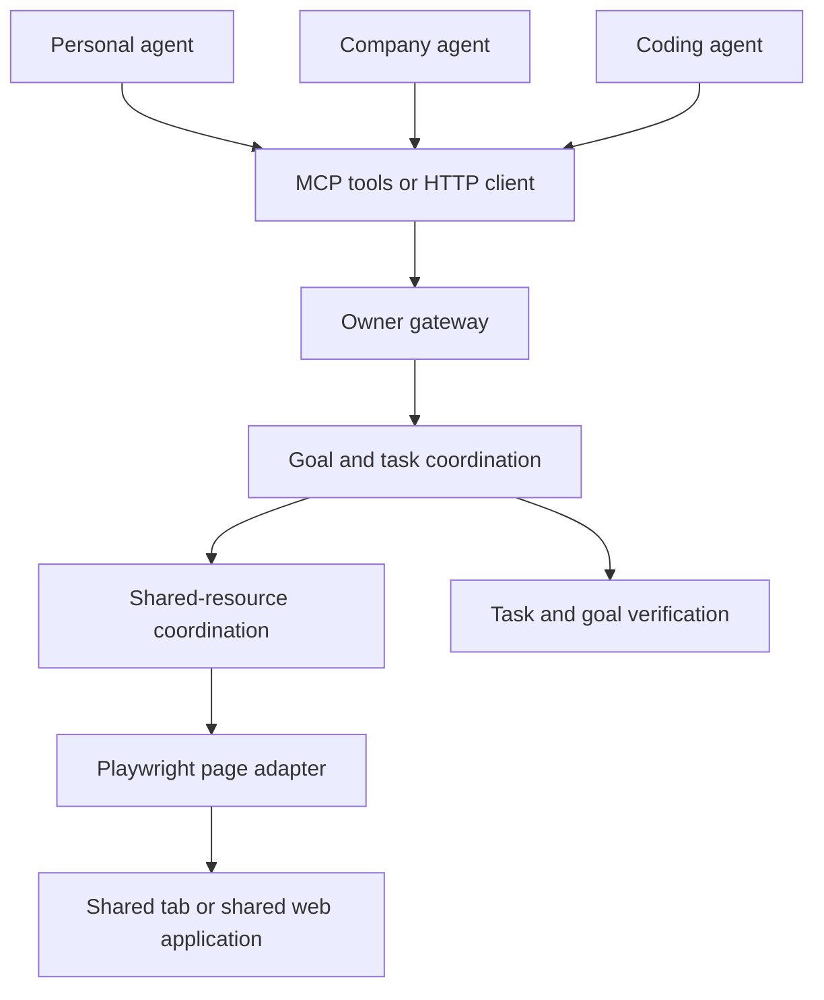

# Architecture

Outsider coordinates agents from different providers around shared interfaces and goals. An owner gateway authenticates agents, binds them to browser pages or other resources, and verifies task and goal results.

Each goal has a task dependency graph and durable work claims. The existing OutcomeProgram runtime determines which tasks are ready. The shared-goal coordinator records claims, renewals, accepted outputs, and resource steps, so another agent can continue from the same task history.

All goals in one owner gateway use the same resource namespace. A resource has its own serialized write access, fencing generation, observed-state version, and stable operation IDs. An action batch stays within one resource operation. If an external effect is uncertain, the coordinator retains its original operation and prevents conflicting writes until it is reconciled.

The Playwright adapter resolves the `Page` associated with each authenticated agent, captures a semantic observation or screenshot, and executes browser actions. Multiple agents may use the same `Page`, or use separate browsers that view an application with shared state. Observations from separate sessions need to describe the same shared state for comparison.

The MCP server runs as one process per agent and goal. It translates standard MCP tool calls to the owner gateway's HTTP API, keeps task claim tokens locally, and renews an active claim. The HTTP client can also be used directly by a different agent framework or language.

The owner provides browser access, authentication, authorization, and task/goal verifiers. The current coordinator runs on one host with durable local files; remote agents can access it through HTTP. Multiple independent owner hosts need a shared distributed coordination service.

## Main components

| Component | Responsibility |
| --- | --- |
| `src/outsider-shared-agent-layer.js` | Multiple goals, authentication-bound HTTP routes, shared resource namespace. |
| `src/outsider-shared-goal-coordinator.js` | Task claims, dependency handoff, accepted outputs, and resource step tracking. |
| `src/outsider-shared-resource-coordinator.js` | Resource ordering, state/version checks, operation identity, and reconciliation. |
| `src/outsider-playwright-browser-adapter.js` | Real page observation, screenshots, browser actions, and browser operation receipts. |
| `src/outsider-mcp-server.js` | MCP tools for a provider's agent host. |
| `src/outsider-shared-agent-client.js` | HTTP client and worker helper. |
| `examples/browser-collaboration.mjs` | Two real browsers, MCP clients, and two goals on one shared page. |

See the [integration guide](MUTUAL-AGENT-LAYER.md) for setup, APIs, and the adapter contract. Run `npm run demo:browser` to exercise the complete path, or `npm run test:browser` for its integration test.
