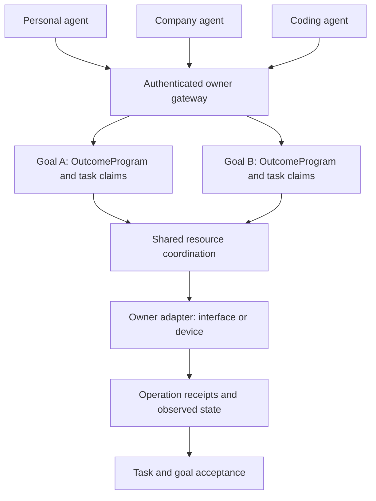

# A mutual layer for agents

**A mutual layer for different agents from different providers—personal, corporate, coding, and others—to operate on the same interface or device toward one or multiple goals.**

Outsider supplies shared task ownership, resource access, handoff, operation history, and acceptance. Each provider supplies its own agent reasoning; each resource owner supplies the real interface/device adapter. HTTP connects them without requiring a common model SDK.

## Run it

```bash
npm ci
npm run demo:shared-goals
npm run demo:shared-goals -- --serve
npm run test:coordination
```

The demo starts four separate worker processes representing three roles:

| Goal | Agent | Contribution to the same page |
| --- | --- | --- |
| `launch` | Personal agent | Writes the heading. |
| `launch` | Company agent | Writes the price, independently of the heading task. |
| `launch` | Coding agent | Publishes after both contributions have been accepted. |
| `branding` | Company agent | Applies a footer while the launch goal progresses. |

All four writes go through one owner gateway. The page, fencing generation, and operation receipts persist in an atomic file. The first write deliberately loses its provider response after committing: the worker reconciles that original operation and continues without another write. The output reports two successful goals, four writes, and at least one reconciliation. `--serve` leaves the resulting page available at the printed localhost origin.

Workers in this example are scripted, so it needs no model credentials. Replace `executeDemoTask` with a provider's actual agent/tool loop to use a personal, enterprise, or coding agent. The HTTP requests, independent processes, owner authentication, page effects, dependency handoff, and recovery path are real.

## Coordination iterations

These are iterations of the shared-agent feature, separate from the financial/evidence Stage 1–4 modules.

| Iteration | Implemented behavior |
| --- | --- |
| V1: shared resource | Exclusive write lease, fencing generation, observed-state checks, stable operation IDs, unresolved-effect reconciliation. |
| V2: shared goal | An existing `OutcomeProgram` DAG feeds a durable work queue. Agents claim independent tasks, hand off accepted outputs, renew claims, and take over expired work. |
| V3: different providers | Authenticated HTTP gateway, provider-independent client, and a worker loop with claim renewal and cancellation signals on ownership loss. |
| V4: one or multiple goals | Multiple goals share one resource namespace. Task generations gate resource dispatch; uncertain operations survive handoff/restart and block conflicting writes across goals. Owner verifiers accept contributions and then the joint result. |

## How it fits together



Task ownership and resource access have different lifetimes. A worker can hold a task while reasoning, waiting on a provider, or working on an independent resource. It acquires the shared resource only around a command. Network/device work runs outside the goal lock; independent resources can execute concurrently. Conflicting writes to the same resource are serialized or receive a retryable contention result.

The goal coordinator compiles tasks into `compileExecutionOnlyProgramV3` and uses `createDurableOutcomeProgramOrchestratorV1` for dependency scheduling and restart. It adds remote work claims and accepted output delivery rather than introducing another DAG scheduler. The resource layer reuses `createSharedResourceCoordinator`.

## Owner integration

```js
import { createServer } from 'node:http';
import { createSharedAgentLayer } from './src/outsider-shared-agent-layer.js';

const layer = createSharedAgentLayer({
  directory: '/absolute/private/outsider-owner',
  authorize: ownerPolicy,
  verifyTask: verifyContribution,
  verifyGoal: verifyJointResult,
  resources: {
    'browser-session': { adapter: ownerBrowserAdapter },
    'shared-device': { adapter: ownerDeviceAdapter, authorize: devicePolicy },
  },
});
const server = createServer(layer.handler({ authenticate: resolveOwnerIdentity }));
server.listen(8080, '127.0.0.1');
```

The named policy, verifier, authentication, and adapter functions are supplied by the owner. The complete local implementation is in [`examples/shared-goals.mjs`](../examples/shared-goals.mjs). A remote deployment can place this gateway behind its normal HTTPS authentication/proxy boundary.

`resolveOwnerIdentity(request)` returns an authenticated `actorId`. Request JSON cannot override that identity. `ownerPolicy` receives `{ actorId, operation, goal, task, resourceId?, action? }` and must return exactly `true`. Operations are `CREATE_GOAL`, `ACTIVATE_GOAL`, `READ_GOAL`, `CLAIM_TASK`, `WORK_TASK`, and `USE_RESOURCE`. The optional resource policy receives the authenticated actor, goal, task, resource ID, and proposed action too.

`verifyContribution({ goal, task, actorId, output, inputs, effects })` returns `{ accepted: boolean, reason?: string }`. A rejected result leaves the claim available for correction with a new submission ID. Accepted dependency outputs, their hashes, and resource receipts accompany later work.

`verifyJointResult({ goal, outputs })` independently evaluates the configured acceptance of the complete goal. Accepted individual tasks do not automatically make the goal succeed. An unavailable/inconclusive verifier keeps the goal active; `resume` repeats observation. These callbacks are owner-configured verification, not a claim of independent institutional authority.

### Define a goal

```js
const definition = {
  goalId: 'launch',
  goal: 'Publish the agreed page',
  completionDeadline: new Date(Date.now() + 600_000).toISOString(),
  acceptance: ['Heading and company terms are present and verified'],
  tasks: [
    { taskId: 'brief', title: 'Prepare the brief', dependsOn: [],
      allowedActorIds: ['personal-agent'] },
    { taskId: 'publish', title: 'Publish the brief', dependsOn: ['brief'],
      allowedActorIds: ['coding-agent'], resourceIds: ['browser-session'] },
  ],
};
```

Use 1–64 tasks with unique IDs and an acyclic dependency graph. Goal, task, and actor IDs start with a letter/number and contain letters, numbers, `.`, `_`, `:`, or `-`, up to 101 characters. `goal_acceptance`, `constructor`, and `prototype` are reserved task IDs. `resourceIds` refer to owner-configured adapters; an empty/missing actor allowlist permits any actor allowed by owner policy. Task `input` can carry a JSON instruction object. Worker outputs are bounded to 64 KiB.

`createGoal` returns a proposed `programHash`; an authorized actor activates that exact hash. This binds the submitted task structure before workers begin. This composition uses the existing execution-only program mode and zero-cost local work admission; it does not reserve paid provider capacity or issue an outcome guarantee.

## Agent integration

```js
import { createSharedAgentClient, runSharedGoalWorker }
  from './src/outsider-shared-agent-client.js';

const client = createSharedAgentClient({
  origin: 'https://owner.example',
  token: process.env.OWNER_AGENT_TOKEN,
});
await runSharedGoalWorker({
  goal: client.goal('launch'),
  executeTask: async ({ task, inputs, effects, resource, signal }) => {
    return providerAgent.execute({ task, inputs, effects, resource, signal });
  },
});
```

The provider's agent loop decides what work to do and returns a JSON output. `inputs` contains accepted dependency outputs and hashes. `effects` contains prior step receipts, including unresolved operations inherited from another worker. `signal` communicates cancellation or ownership loss; a command already dispatched still needs its actual result reconciled.

`resource.observe({ resourceId })` returns `{ version, stateHash, state }`. Submit a command using `resource.perform({ resourceId, stepId, action, expectedVersion, expectedStateHash })`. Use `resource.reconcile({ resourceId, stepId })` to resolve the original step. The helper binds the current task ID, private claim ID, and generation to all three calls.

Resource step statuses are `APPLIED`, `NOT_APPLIED`, `NOT_DISPATCHED`, and `RECONCILIATION_REQUIRED`. A repeated identical step returns its existing result. A changed request under the same step ID is rejected. After a known non-effect, the agent may observe again and explicitly propose a fresh step. An uncertain effect must be reconciled first; completion remains blocked while any of the task's steps is unresolved. The client never automatically retries mutations.

The worker renews its task claim, works outside owner locks, and polls for more work. It stops on goal success/failure, a rejected contribution, or cancellation. A rejected contribution returns `TASK_REJECTED` and is handed off, so the provider can decide how to correct it. Set `ttlMs`, `pollMs`, or `signal` when needed; low-level claim/renew/complete methods remain available for existing agent runtimes.

### HTTP surface

All responses are JSON. POST bodies are JSON, bounded to 128 KiB. The client uses an owner-issued bearer credential; the server's authentication callback can resolve whatever transport identity the deployment supports.

| Endpoint | Purpose |
| --- | --- |
| `POST /v1/goals` | Create `{ goal: definition }`. |
| `GET /v1/goals` | List goals readable by this actor. |
| `GET /v1/goals/:goalId` | Inspect goal, task status, receipt summaries, and audit head. |
| `POST /v1/goals/:goalId/activate` | Activate `{ programHash }`. |
| `POST /v1/goals/:goalId/claim` | Claim `{ taskId?, ttlMs? }`; returns a claim or current goal status. |
| `POST /v1/goals/:goalId/renew` | Renew `{ taskId, leaseId, generation, ttlMs }`. |
| `POST /v1/goals/:goalId/abandon` | Hand off `{ taskId, leaseId, generation }`. |
| `POST /v1/goals/:goalId/complete` | Submit those claim fields plus `{ submissionId, output }`. |
| `POST /v1/goals/:goalId/resume` | Resume the persisted program and repeat pending verification. |
| `POST /v1/goals/:goalId/resources/observe` | Observe with claim fields and `{ resourceId }`. |
| `POST /v1/goals/:goalId/resources/perform` | Add `{ resourceId, stepId, action, expectedVersion, expectedStateHash }`. |
| `POST /v1/goals/:goalId/resources/reconcile` | Reconcile with claim fields and `{ resourceId, stepId }`. |

The JavaScript client mirrors the operations under `client.goal(goalId)`, plus `createGoal` and `listGoals`. Any other language or agent framework can use the HTTP protocol directly.

## Resource and persistence boundary

Register each actual interface/device once in the owner resource namespace. All goals in one `createSharedAgentLayer` instance use the same resource directory; reconstructing the layer with that directory preserves task generations, step identities, and unresolved operations. Standalone goal coordinators must also share their `resourceDirectory` to coordinate with each other.

The adapter contract is the [existing resource contract](SHARED-RESOURCE-COORDINATION.md#adapter-contract-and-write-boundary): observe, conditionally execute, and reconcile a stable operation ID. The goal composition additionally supplies `goalId`, `taskId`, `agentId`, and `claimGeneration` on execution. Owner-side resource actor IDs include the goal, task, and claim generation, so the same personal/company agent working on two goals does not accidentally reuse a resource grant.

A task takeover revokes permission to start another command. A previously dispatched effect stays recorded until its result is known. The next worker reconciles the original operation before moving on. It cannot finish the task merely because the previous worker's claim expired.

This implementation supports remote workers connected to a single owner host, with local durable storage and same-host process exclusion. Multiple owner hosts sharing a filesystem need a distributed lease service. Actual browsers/devices need a real owner adapter. Goal acceptance records completion at observation time; continuously maintaining incompatible goals requires an explicit owner priority/conflict policy.

## Source map

- [`outsider-shared-agent-layer.js`](../src/outsider-shared-agent-layer.js): multiple goals, common resource namespace, authentication-bound HTTP routes.
- [`outsider-shared-agent-client.js`](../src/outsider-shared-agent-client.js): HTTP client and renewable worker loop.
- [`outsider-shared-goal-coordinator.js`](../src/outsider-shared-goal-coordinator.js): existing program composition, task claims, output handoff, resource step receipts, acceptance.
- [`outsider-shared-resource-coordinator.js`](../src/outsider-shared-resource-coordinator.js): exclusive write access, fencing, observed-state checks, operation reconciliation.
- [`outsider-shared-agent-layer.test.js`](../test/outsider-shared-agent-layer.test.js): real HTTP, multiple goals, concurrent independent resources, takeover, unknown effects, and the four-process page scenario.
